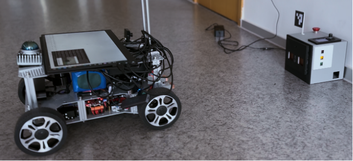
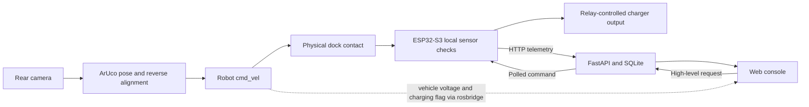

# Autonomous Docking and Charging for Agricultural Robots

A prototype charging system for an Ackermann agricultural robot, combining rear-camera ArUco alignment, an ESP32-S3 charging dock, and a web console for monitoring and charge scheduling.

The robot handles physical alignment; the dock checks local contact and sensor conditions before switching charging power. The web service records telemetry and sends high-level requests through the existing firmware protocol.



*Indoor prototype photograph from the project poster. The application context is agricultural harvesting; the supplied evidence does not establish outdoor reliability.*

[Download the original demonstration video (MP4, 178 MB)](https://github.com/dddddddddl/agricultural-robot-autonomous-charging/releases/download/portfolio-v1.0/autonomous_charging_demonstration_original_zh.mp4) · [English project poster](docs/presentation/autonomous_docking_project_poster.pptx)

## Start here

| To understand… | Open… |
|---|---|
| The project and its component boundaries | [System architecture](docs/architecture.md) |
| Low-battery return to the charging station | [Return manager](robot/navigation/auto_charge/README.md) |
| Reverse docking and marker pose estimation | [Vision controller](robot/vision/README.md) |
| Sensor checks, state transitions and relay control | [ESP32-S3 firmware](firmware/esp32s3/README.md) |
| The dashboard, telemetry API and charging schedule | [Web console](web/README.md) |
| Camera calibration and the original 31-image dataset | [Calibration](robot/calibration/README.md) |
| PCB, Gerbers, enclosure and wiring | [Hardware](hardware/README.md) |
| The original project report and demonstration | [Supporting materials](docs/README.md) |
| What has actually been checked | [Validation record](docs/validation.md) |

## What is included

- **Low-battery return:** a ROS 2 C++ node monitors battery state, requests cancellation of navigation goals, sends a Nav2 goal to the charging station staging pose, and publishes `/start_docking` on arrival.
- **Visual docking:** OpenCV detects `DICT_4X4_50` marker ID 0 and estimates its pose using calibrated OV9281 intrinsics. The supplied controller reverses at low speed, filters lateral error and bearing, applies alignment hysteresis, and stops on the configured distance or vehicle charging flag.
- **Embedded charging control:** a PlatformIO/Arduino project for ESP32-S3 reads a VL53L1X, micro-switch, INA226, analog NTC and emergency-stop input. The local state machine owns the relay. HTTP uploads and command polling run in a separate FreeRTOS task.
- **Monitoring and planning:** FastAPI, SQLite and a plain JavaScript frontend provide telemetry, history, estimated vehicle charge, staged charging schedules, reference tariff display and optional model-assisted reports. The offline report path requires no API key.
- **Hardware and evidence:** an editable PCB project, fabrication layers, enclosure STL, engineering drawings, design renders, calibration inputs/results, an English project poster, the original report, a demonstration video and award documentation.

### Source scope

The robot software includes a Nav2 low-battery return manager and a standalone vision docking node. The return manager publishes `/start_docking`, but the vision node does not subscribe to it. Automatic handover, docking completion feedback and mission resumption still need integration. See the [implementation coverage table](docs/architecture.md#implementation-coverage).

## System overview



The charger and vehicle BMS remain responsible for battery charging regulation. Dock firmware adds local switching and monitoring; the web service is a prototype LAN application, not a production remote-control deployment.

## Run the web console without hardware

Use Python 3.10 or newer; Python 3.12 was used for the recorded checks. Run from the repository root:

```bash
python3 -m venv .venv
source .venv/bin/activate
python -m pip install -r web/backend/requirements.txt
python -m uvicorn main:app --app-dir web/backend --host 127.0.0.1 --port 8000
```

Open **http://127.0.0.1:8000**. A fresh SQLite database is created locally. With no vehicle connected, its charge estimate remains unknown.

For a software-only demonstration in a separate terminal:

```bash
curl -X POST http://127.0.0.1:8000/api/dev/mock-status \
  -H 'Content-Type: application/json' \
  -d '{"scenario":"charging","points":24}'
```

Refresh the page and select **View weekly report**. These records are synthetic; use a fresh database for real telemetry. The [web guide](web/README.md) explains optional services and real dock/vehicle connections.

## Build and inspect the hardware modules

Build the firmware with PlatformIO:

```bash
pio run -d firmware/esp32s3
```

Before connecting a physical dock, follow the [firmware configuration guide](firmware/esp32s3/README.md) and [wiring notes](hardware/wiring.md). The selected firmware and older hardware notes use different GPIO assignments; the repository documents that mismatch rather than silently changing the controller.

The [robot guide](robot/README.md) explains the ROS 2 prerequisites and standalone controller. No robot, camera or dock is needed to inspect the code or run the host checks.

## Results and evidence

| Evidence | Result and interpretation |
|---|---|
| Camera dataset and saved calibration | 31 views at 1280 × 720; 11 × 8 inner corners; 10 mm squares |
| Re-run of supplied calibration | OpenCV RMS **0.13130584 px**; script-specific mean error **0.01395080**; [metric definition](robot/calibration/README.md#calibration-results) |
| Firmware build | ESP32-S3 build passed; RAM 47,348 bytes and flash 974,513 bytes in the recorded environment |
| Host software checks | 11 Python checks plus the JavaScript missing-data renderer check passed; the ROS return package has not been built or run on this host |
| Original prototype evidence | [English poster](docs/presentation/autonomous_docking_project_poster.pptx), [original report](docs/report/project_report_original.docx), [video guide](docs/media/README.md) |

Calibration error measures image reprojection, **not physical docking accuracy**. Docking success rate, docking time, outdoor performance and physical safety response timing were not measured in this repository preparation. Original project claims and newly run checks are distinguished in the [validation record](docs/validation.md).

## Recognition and attribution

**First Prize, East China Division, 2026 National Undergraduate IoT Design Contest.** The [supplied certificate](docs/recognition/2026_east_china_iot_first_prize.pdf) documents a team award, not a national final ranking or an individual award.

The supplied SURF poster credits **Siyuan Lin, Xunuo Zhuang and Yuhan Qiu**, with supervisors **Xiaohui Zhu and Yong Yue**, at Xi'an Jiaotong-Liverpool University (SURF 0639). This portfolio repository presents the supplied project materials; individual ownership of particular modules is not inferred from file names. See [provenance and preparation changes](docs/provenance.md).

## Limitations

- The return manager is included; waypoint mission execution, deployment maps, vehicle drivers and the full Nav2 configuration are not included.
- The standalone controller has no `/start_docking` authorization subscription or `/docking_complete` result publisher. Running it alongside Nav2 requires velocity arbitration.
- Firmware charge-complete thresholds and battery/charge-rate assumptions require calibration on the actual platform.
- Scheduling uses estimated vehicle charge and observed usage times; the supplied scheduler does not optimize against tariff periods.
- The API has no authentication/TLS and retains a development mock endpoint. Keep it on localhost for review; physical integration belongs on a controlled network.
- The original report, video and some engineering drawings retain their supplied language. English guides provide the reading entry points; no translated video or reviewed translation of the opaque report is claimed.

No repository-wide open-source license has been added. Third-party code is identified in [THIRD_PARTY_NOTICES.md](THIRD_PARTY_NOTICES.md).
