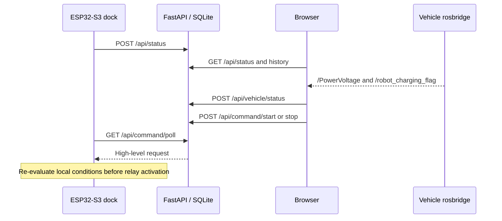

# System architecture

The agricultural robot charging problem has two different control scales: navigating near a fixed station and aligning conductive contacts at low speed. The project separates the vehicle's motion task from the dock's decision to switch power, with monitoring and scheduling in a third layer.

## Implementation coverage

| Capability | Evidence in the supplied materials | Repository status |
|---|---|---|
| ArUco detection and PnP pose | Standalone `aruco_docking3.py` | Executable source in `robot/vision/` |
| Low-speed reverse alignment | Lateral/bearing filtering, hysteresis and steering slew limits | Executable source; host decision/pose checks passed |
| Local interlocks and relay state machine | IoT ESP32-S3 project | Executable source; firmware build passed |
| HTTP telemetry and command requests | Firmware and FastAPI modules | Both sides supplied; host API checks passed |
| Dashboard and rosbridge voltage view | Browser frontend and ROSLIB | Supplied; local browser rendering checked; no real rosbridge connection tested |
| Calibration pipeline | Tools, 31 inputs, overlays and saved intrinsics | Supplied; scratch calibration re-run reproduced saved metrics |
| PCB and enclosure | EasyEDA Pro, Gerbers, STL, drawings | Preserved design files; no electrical/manufacturing validation performed |
| Low-battery Nav2 return manager | Described in technical notes and poster | Corresponding source packages absent from provided archives |
| Nav2/vision authorization and completion handshake | `/start_docking`, `/docking_complete` described in later notes | Absent from supplied standalone vision script |
| Kalman/yaw controller and visual Hybrid A* | Described as later v14/v16 implementations | Not included as executable source |
| Automatic mission resumption | Described at project level; earlier navigation note lists gaps | Not reproducible from the supplied source set |

The architecture documents span different development stages. Newer-sounding filenames and document assertions are not treated as proof that an implementation exists in this archive.

## Vehicle perception and motion

The rear OV9281 camera detects a known-size ArUco marker. Calibrated camera intrinsics and distortion coefficients support IPPE Square pose estimation, with iterative PnP used after an OpenCV exception. The marker's camera-frame translation provides lateral offset `x` and range `z`; `atan2(x, z)` gives bearing.

The supplied controller low-pass filters lateral offset and bearing. Separate entry/exit tolerances reduce alignment-state oscillation. During alignment, the Ackermann platform still reverses slowly because it cannot turn in place. Angular slew limiting smooths steering commands. Target loss, range limits and the charging flag produce stop decisions.

That controller is a local standalone module. It does not generate a map-level path or arbitrate Nav2 goals.

## Dock sensing and power control

The fixed dock reads five kinds of evidence:

1. ToF distance to the approaching vehicle.
2. Stable mechanical contact through an insulated trigger and micro-switch.
3. INA226 bus voltage, shunt-derived current and power.
4. Analog NTC contact temperature.
5. Normally closed emergency-stop input.

The firmware initializes the relay OFF and checks the local state before activation. Automatic start requires stable position and valid sensor/interlock readings, followed by a 600 ms stable period and fresh reads. Severe faults or emergency stop latch FAULT and request relay-off. Contact loss and other conditions have their own debounce/confirmation logic; exact physical reaction time has not been measured here.

`enforceRelaySafetyInvariant()` handles relay-on outside CHARGING as a fault. STOP holds charging off while the vehicle remains docked; START releases that deliberate hold but does not force power on. CLEAR_FAULT rechecks physical recovery. Backup charge completion is latched until vehicle departure.

Wi-Fi/HTTP work is queued to a separate FreeRTOS task. That separation reduces network blocking in the main loop; it is not a formal real-time or functional-safety certification.

## Service layer and data flow

Vehicle charge is estimated from the original piecewise voltage curve. Dock voltage and power remain separate signals. SQLite records telemetry, charging sessions, vehicle events, settings, plans and reports. Scheduling uses usage history; tariff reference display is independent. Optional cloud reports receive summarized data and produce advice, never raw relay GPIO authority.

## Engineering boundaries

The supplied code has no complete deployment launch system, vehicle drivers, map, camera extrinsics or documented velocity mux. Hardware notes also conflict with the selected firmware's GPIO map. These boundaries are explicit so the repository can be evaluated as a collection of implemented modules and preserved prototype evidence without implying an independently reproduced full robot mission.
