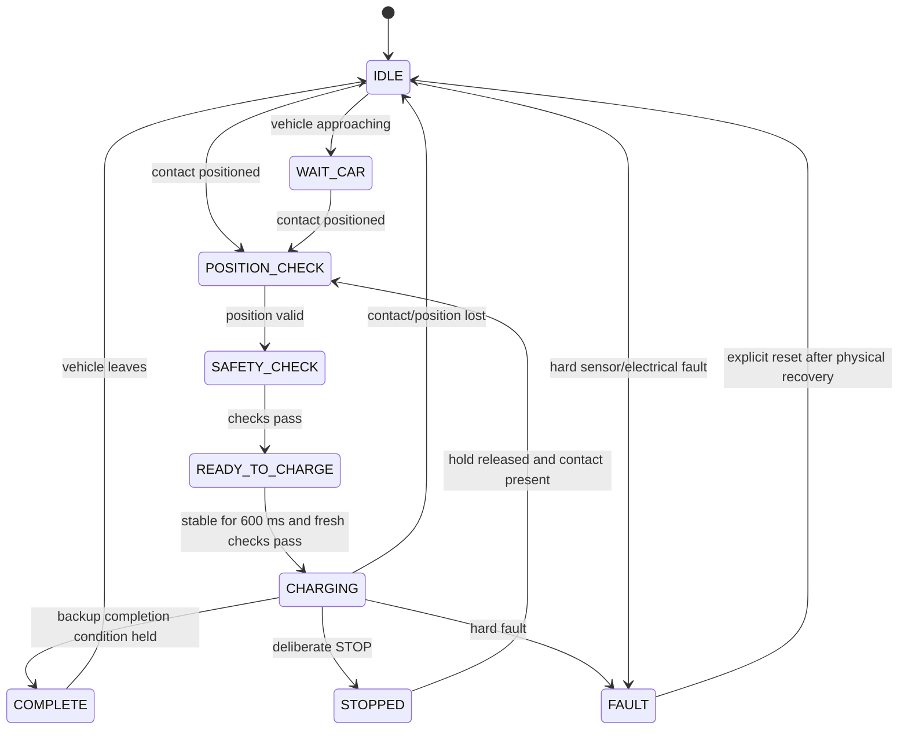

# ESP32-S3 charging dock firmware

This is the Safety V11.1 firmware selected from the supplied IoT archive. Its source and PlatformIO configuration match the expanded `Auto_charge/ESP32S3` copy byte for byte before repository preparation. The alternative nested copy changes electrical thresholds; it was not silently substituted. See [version provenance](../../docs/provenance.md).

## Build and configure

Install PlatformIO Core, then run from the repository root:

```bash
pio run -d firmware/esp32s3
```

For Wi-Fi, copy the template and edit the ignored local file:

```bash
cp firmware/esp32s3/include/local_config.example.h firmware/esp32s3/include/local_config.h
```

Set the 2.4 GHz SSID, password and backend LAN URL in `local_config.h`. Without the file, empty SSID/password defaults leave Wi-Fi unconfigured; local firmware still compiles. The backend default uses port 8000. No original credentials are included.

The supplied board configuration targets `esp32-s3-devkitc-1`, Arduino, 8 MB flash and 8 MB Octal PSRAM (`qio_opi`). It was built with `espressif32` 7.1.3 and Arduino-ESP32 2.0.17 in the recorded environment. The source configuration remains unpinned, as supplied; see [validation](../../docs/validation.md) for the actual resolved dependencies.

After checking the real board and wiring, PlatformIO's usual upload/monitor commands apply:

```bash
pio run -d firmware/esp32s3 -t upload
pio device monitor -d firmware/esp32s3 -b 115200
```

No upload to physical hardware was performed during repository preparation.

## Code map

| Files | Responsibility |
|---|---|
| `src/main.cpp` | GPIOs, thresholds, sensor scheduling, state machine, status JSON and serial commands |
| `EmergencyStop`, `MicroSwitchSensor`, `ToFSensor` | Local position and stop inputs |
| `INA226Sensor`, `TempSensor` | Electrical sensing and analog NTC temperature |
| `RelayControl` | Output control with OFF initialization |
| `WiFiDockModule` | FreeRTOS HTTP worker, telemetry and high-level command polling |
| `BuzzerModule`, `LedIndicator`, `TftDisplayModule`, `TftKnobModule` | Local indicators and display/input diagnostics |

Header/source pairs are in `include/` and `src/`. Start with the constants and `updateStateMachine()` in `main.cpp`, then read `chargeSafetyOK()`, `enforceRelaySafetyInvariant()` and command handling.

## Local state flow



The diagram condenses the code; emergency stop and faults can interrupt more than the illustrated transitions. Network requests do not directly set relay GPIO. Local automatic charging can start without a web request when all conditions pass. `CLEAR_FAULT` requires the physical fault to clear, and `COMPLETE` remains latched until contact release.

## Selected thresholds

| Check | Configured value |
|---|---|
| ToF acceptance | 1–150 mm |
| Bus voltage | 20–28 V |
| Absolute current | up to 3.0 A |
| NTC warning / cutoff | 45 / 55 °C |
| Switch debounce / extra stable-on period | 80 / 250 ms |
| Startup stability | 600 ms |
| Backup completion | at least 60 s charging, ≥25.2 V and ≤0.20 A held for 90 s |
| Status upload / command poll | 5 s / 1.5 s |
| HTTP timeout | 500 ms |

These are source configuration values, not independently calibrated safety ratings. The backup completion criteria do not replace the original charger/BMS. Some faults use confirmation windows; the loop is polled and contains bounded sensor waits, so an exact physical cutoff latency is not established by a successful build.

Consult the [GPIO and power wiring notes](../../hardware/wiring.md) before applying power. Earlier notes refer to different pins and a digital temperature option; this snapshot uses analog NTC on GPIO4.
