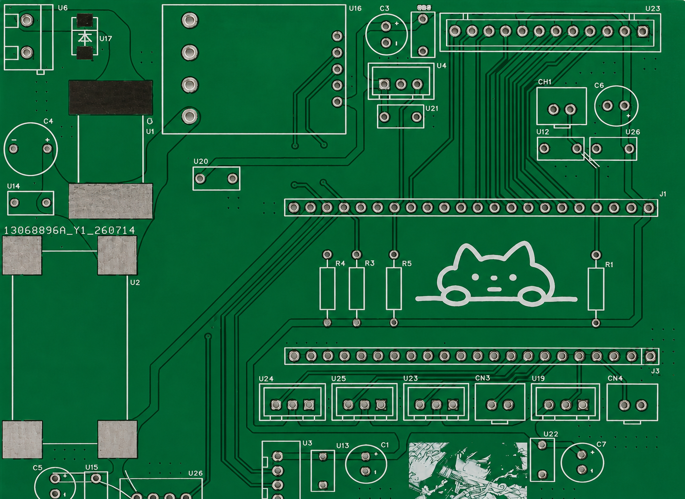

# Charging dock hardware

The station combines a modular low-voltage power path, ESP32-S3 sensing/control, compliant charging contacts and a serviceable enclosure.

Read [wiring.md](wiring.md) before using the design. Source documents span different wiring revisions: the selected firmware pin map is explicit, but correspondence to a manufactured board has not been verified by continuity testing.

## Files

| Path | Description |
|---|---|
| `pcb/charging_dock.epro2` | Supplied editable EasyEDA Pro project, renamed from its dated export |
| `pcb/gerbers/` | Complete supplied fabrication layer/drill set |
| `mechanical/dock_camera_assembly.stl` | Combined charging dock, camera and adapter assembly |
| `mechanical/enclosure_frame_drawing.pdf` | Original enclosure frame drawing |
| `mechanical/front_enclosure_drawing.pdf` | Original front enclosure drawing |
| `mechanical/*view.png`, `*assembly.png`, `*render.png`, `*design.png`, `wireframe*.png` | Supplied mechanical design iterations and views |
| [`../assets/circuit_schematic.png`](../assets/circuit_schematic.png) | Circuit overview extracted unchanged from the English poster |
| [`../assets/pcb_layout.png`](../assets/pcb_layout.png) | PCB overview extracted unchanged from the poster |

The CAD, STL and fabrication files are preserved without geometric/electrical redesign. Original drawing labels may remain in Chinese; the English wiring guide is the reading entry point. Vendor example projects and component shopping screenshots are excluded because they are not the project's implementation or a complete verified BOM.

## Mechanical interface

The project design describes spring-supported positive/negative copper plates that accommodate small contact-position errors. A retractable insulated center trigger operates a separate micro-switch without carrying charging current. Mechanical presence alone does not authorize relay activation: distance, electrical, temperature and emergency-stop conditions are checked locally.

The STL is a combined assembly, not a set of verified individually printable production parts. Drawing tolerances, material selection, weather sealing and outdoor contamination resistance need physical validation.
