# Low-battery return manager

`auto_charge_manager` monitors battery state and asks Nav2 to return the robot to a configured charging station staging pose. On successful arrival, it publishes `/start_docking = true`.

This package handles return-to-station task selection. It does not publish velocity commands, align the charging contacts or switch charging power.

## Files

- `src/auto_charge_manager.cpp`: battery callback, state transitions, navigation cancellation, return goal and retries.
- `package.xml`: ROS dependencies and existing package metadata.
- `CMakeLists.txt`: C++17 executable and installation rules.

## Build

Use an existing ROS 2 Humble/Nav2 installation with `colcon`, `ament_cmake`, `rclcpp`, `rclcpp_action`, `sensor_msgs`, `geometry_msgs`, `std_msgs`, `nav2_msgs`, `tf2` and `tf2_geometry_msgs`.

From the repository root:

```bash
source /opt/ros/humble/setup.bash
colcon build --base-paths robot/navigation --packages-select auto_charge
source install/setup.bash
```

The package has not been compiled or run on the macOS preparation host, which has no ROS 2 installation. Static package checks and preservation of the C++ program tokens were verified; this is not a ROS build result.

## Run with the vehicle

Start the vehicle's existing localization, map and Nav2 system first. Measure the pre-docking pose in its map frame. Supply those measured values through `staging_x`, `staging_y` and `staging_yaw`:

```bash
ros2 run auto_charge auto_charge_manager --ros-args \
  -p staging_x:="$STAGING_X" \
  -p staging_y:="$STAGING_Y" \
  -p staging_yaw:="$STAGING_YAW"
```

Set those shell variables before running the command. Positions are meters and yaw is radians. The zero defaults are not a calibrated station location.

## State flow

```mermaid
stateDiagram-v2
    [*] --> NORMAL
    NORMAL --> CANCELING: five consecutive low samples
    CANCELING --> RETURNING: delay elapsed and Nav2 server available
    RETURNING --> AT_STAGING: goal succeeded; publish start_docking
    RETURNING --> RETURNING: retry after failure
    RETURNING --> FAILED: retry budget exhausted
    CANCELING --> FAILED: server unavailable and retries exhausted
    NORMAL --> CHARGING: charging/full battery status
    AT_STAGING --> CHARGING: charging/full battery status
    FAILED --> NORMAL: recovered battery and not charging
    CHARGING --> NORMAL: recovered battery and no longer charging
```



Charging/full status is checked at the start of each battery callback and can also change other active states to CHARGING. The diagram summarizes the intended sequence; it does not prove that pending navigation goals or timers are canceled when that status changes.

## Parameters

| Parameter | Default | Meaning |
|---|---|---|
| `battery_topic` | `/battery_status` | `sensor_msgs/msg/BatteryState` input |
| `use_voltage` | `false` | Use voltage instead of percentage when true |
| `low_threshold` | `0.25` | Low threshold in the selected input's units |
| `reset_threshold` | `0.35` | Recovery threshold for FAILED/CHARGING |
| `confirm_count` | `5` | Consecutive low samples, not seconds |
| `map_frame` | `map` | Frame for the staging goal |
| `staging_x`, `staging_y`, `staging_yaw` | `0.0` | Station staging pose; must be measured |
| `cancel_wait_ms` | `800` | Fixed delay after navigation cancellation requests |
| `max_return_retries` | `2` | Additional retries; at most three attempts |

Percentage uses the ROS BatteryState range **0–1**, so `0.10` means 10%. In voltage mode, replace **both** thresholds with values measured for the actual battery; keeping 0.25/0.35 would not be meaningful voltage configuration.

Invalid non-finite input is ignored. A non-low finite sample resets the low-sample counter. Once a return is active, low samples do not start a second return. Charging/full status clears the low count and publishes return-active false.

## Interfaces

| Direction | Interface | Type / behavior |
|---|---|---|
| Subscribe | configured battery topic | `sensor_msgs/msg/BatteryState`, sensor-data QoS |
| Action client | `/navigate_to_pose` | Cancels existing goals and sends the staging goal |
| Action clients | `/navigate_through_poses`, `/follow_waypoints` | Requests cancellation of existing tasks |
| Publish | `/return_to_charge_active` | `std_msgs/msg/Bool`; external mission gate must consume it |
| Publish | `/start_docking` | `std_msgs/msg/Bool`; true on staging-goal success |

The action and output-topic names are absolute in this snapshot. Navigation failures schedule another attempt after 2 seconds until the retry budget is exhausted.

## Isolated battery-input test

The original manual test uses a separate battery topic so simulated battery messages do not replace vehicle telemetry. It still sends a real navigation goal when Nav2 is running. Use a simulator or a controlled robot test area with a measured staging pose.

```bash
ros2 run auto_charge auto_charge_manager --ros-args \
  -p battery_topic:=/test_battery_status \
  -p confirm_count:=1 \
  -p staging_x:="$STAGING_X" \
  -p staging_y:="$STAGING_Y" \
  -p staging_yaw:="$STAGING_YAW"
```

In another sourced terminal:

```bash
ros2 topic pub --once /test_battery_status sensor_msgs/msg/BatteryState \
  '{percentage: 0.10, power_supply_status: 2, present: true}'
```

Observe `/return_to_charge_active`, the Nav2 goal/result and `/start_docking`. This manual test was not executed during repository preparation.

## Current integration limits

- Cancellation is asynchronous; the node waits a fixed interval rather than confirming the cancellation results.
- Publishing return-active does not itself block new waypoint goals. A mission gate must enforce that priority.
- The [vision controller](../../vision/README.md) does not subscribe to `/start_docking`, so automatic handover is not connected.
- There is no `/docking_complete` subscriber, docking timeout or saved waypoint resumption in this package.
- `/start_docking` is published as a one-time true message without a false/reset handshake or durable delivery.
- Timer/goal callbacks are not guarded by a return-attempt generation ID. Charging-status changes do not explicitly cancel pending return work.
- FAILED logs a low-battery lock state; it does not directly stop the chassis or enforce a system-wide task lock.

These are limits of the preserved implementation. The package provides the return-to-staging component, not a complete unattended charging mission.
